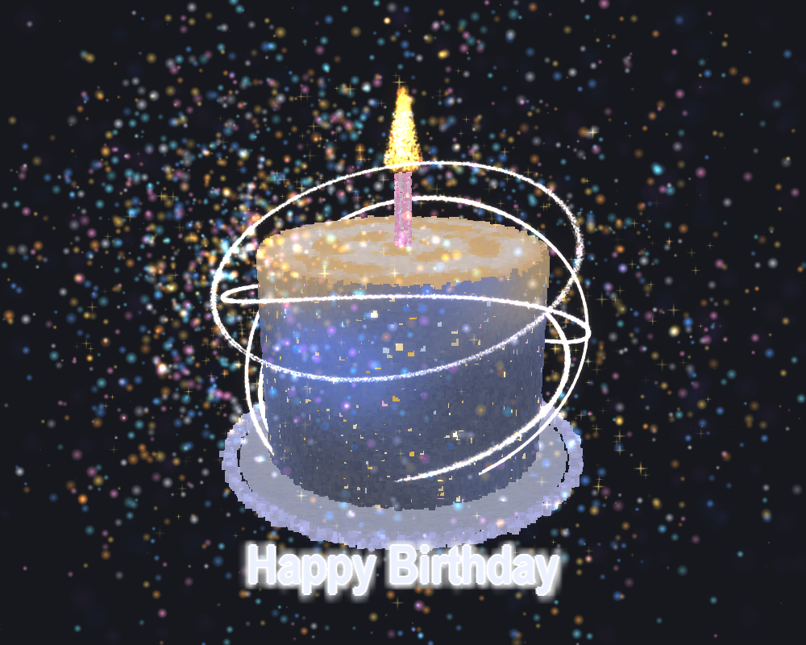

# 🎂 3D Birthday Cake
[Tiếng Việt](#VIE) | [English](#ENG)
## VIE
# Happy Birthday —— Bánh Sinh Nhật 3D

Một chiếc bánh sinh nhật 3D được dựng hoàn toàn từ các hạt (particles). Toàn bộ khung cảnh (bánh kem, dĩa, dải ruy-băng, ngọn lửa, nến, giấy vụn confetti, tinh vân) đều là các điểm hạt (points), không hề có bất kỳ hình tam giác (triangle) hay hình dán mô hình (model texture) nào, và cũng **không dùng dù chỉ một dòng mã lệnh GLSL** —— toàn bộ quy trình chạy trên đường ống cố định (Fixed Function Pipeline) của OpenGL.



Hình ảnh tham khảo là `preview.png`, rất nhiều thông số bên dưới được đo đạc tỉ mỉ dựa trên hình này.

---

## Cài đặt & Chạy chương trình

```bash
pip install pygame PyOpenGL numpy
python birthday_cake.py
```

> **Dành cho Python 3.13 trở lên**: Thư viện chính thức `pygame` chưa có bản wheel tương thích, bạn chỉ cần cài `pygame-ce` (`pip install pygame-ce`). Thư viện này cung cấp tên module tương tự là `pygame`, vì vậy không cần sửa đổi mã nguồn.

Chế độ chụp ảnh màn hình để kiểm thử —— lưu thành file `preview.png` sau khi render 90 khung hình rồi tự động thoát, không cần giữ cửa sổ mở:

```bash
python birthday_cake.py --shot
```

## Thao tác điều khiển

| Thao tác | Hiệu ứng |
|---|---|
| Nhấp giữ chuột trái và kéo | Xoay góc nhìn |
| Cuộn chuột | Phóng to / Thu nhỏ góc nhìn |
| Phím `ESC` / Đóng cửa sổ | Thoát chương trình |

---

## Chi tiết kỹ thuật

### Tất cả đều là điểm hạt (Points)

Mỗi hệ thống là một tập hợp hạt, tọa độ vị trí và màu sắc được lưu trong từng VBO riêng biệt, sử dụng `glVertexPointer` / `glColorPointer` / `glDrawArrays(GL_POINTS)` để vẽ. Khi kích thước hạt khác nhau, chúng được phân chia thành từng nhóm cỡ hạt, mỗi nhóm thực hiện một lần gọi `glPointSize` + `glDrawArrays`. Các hệ thống có chuyển động theo thời gian sẽ cập nhật dữ liệu bằng `glBufferSubData` ở mỗi khung hình.

Tổng số hạt hiện tại là **216,760**:

| Thành phần | Số lượng | Thành phần | Số lượng |
|---|---:|---|---:|
| Bánh kem | 82,000 | Giấy vụn Confetti | 3,000 |
| Vòng hào quang | 95,000 | Ngôi sao | 1,500 |
| Dĩa đựng | 28,000 | Tinh vân | 900 |
| Ngọn lửa | 5,200 | Nến | 700 |

### Hai phương pháp vẽ hoàn toàn khác nhau

- **Bề mặt thể rắn** (Bánh kem, dĩa, nến): Các điểm hạt hình vuông không dán texture, tắt chế độ làm mịn điểm `GL_POINT_SMOOTH`, kết hợp `GL_LESS` + ghi độ sâu (depth writing) + hòa trộn đè (overlapping blend), độ trong suốt alpha được nhân trước vào RGB. Mỗi điểm ảnh cơ bản chỉ do một hạt quyết định, độ sáng hoàn toàn đến từ màu sắc tự thân của hạt. Không được đổi `GL_LESS` thành `GL_LEQUAL`, nếu không lớp vỏ mỏng ngoài cùng sẽ bị cháy sáng (overexposed).
- **Vật thể phát sáng** (Vòng hào quang, ngọn lửa, confetti, tinh vân): Sử dụng dán hình quả cầu ánh sáng mềm (soft light sphere texture) + hòa trộn cộng dồn (Additive Blending: `GL_SRC_ALPHA, GL_ONE`), không ghi độ sâu nhưng **vẫn chấp nhận kiểm tra độ sâu (Depth Test)** như bình thường, nhờ đó nửa vòng phía sau bánh kem vẫn được che khuất chính xác.

### Tạo hiệu ứng phát sáng (Glow/Bloom) không dùng Shader

Sử dụng Off-screen FBO Rendering → Trích xuất ngưỡng độ sáng (Brightness threshold extraction) → Làm mờ Gaussian phân tách bán kính nhỏ (Separable Gaussian Blur - vẽ lặp lại nhiều lần theo ma trận texture để tích lũy, tầng gần dùng bán phân giải) → Hòa trộn cộng dồn trở lại màn hình.

Bước trích xuất độ sáng được tạo ra từ việc kết hợp hai phương hình hòa trộn:

```
bright = clamp(scene * GAIN - THRESHOLD, 0, 1)
```

Sử dụng `glBlendFunc(GL_ONE, GL_ONE)` đi kèm với `glBlendEquation(GL_FUNC_REVERSE_SUBTRACT)`.

Một lưu ý quan trọng: **Quá trình tổng hợp là phép cộng chứ không phải phép nội suy** (`a0*Ảnh gốc + a1*Tầng gần + a2*Tầng xa`), do đó bất kỳ điểm ảnh nào vượt qua ngưỡng độ sáng đều sẽ **sáng lên**, chứ không chỉ đơn thuần là "có thêm một vòng hào quang". Nếu đặt ngưỡng quá thấp, toàn bộ bức ảnh sẽ bị nhòe.

### Ruy-băng là sóng lan truyền, không phải rung lắc ngẫu nhiên

Vòng hào quang ban đầu dùng cơ chế `ParticleSystem` (mỗi hạt tự rung lắc lên xuống theo tần số ngẫu nhiên), dẫn đến 95,000 hạt rung lắc hỗn loạn, trên màn hình chỉ thấy một lớp rìa xù xì và chuyển động trông như bị rung giật.

Hiện tại đã đổi thành: Tọa độ `θ` của từng hạt, góc nghiêng mặt phẳng quỹ đạo, bán kính/chiều cao cơ sở đều được lưu vào `anim` và tính toán lại ở mỗi khung hình qua `ring_animate()`. Nhờ đó, cùng một vòng ruy-băng tại một thời điểm chỉ có một pha duy nhất, đỉnh sóng di chuyển dọc theo chiều dài cung với tốc độ cố định. Đây mới chính là hiệu ứng "dải ruy-băng đang bay lượn".

Ngoài ra, độ dày của vòng **bắt buộc phải để bề dày hình học lớn hơn kích thước texture hạt** (texture hạt từ 2~4 pixel). Ban đầu `RING_WIDTH = 0.0045` quy đổi ra màn hình chưa tới 1 pixel, hẹp hơn cả texture, khiến bề dày của vòng bị phụ thuộc hoàn toàn vào texture —— dẫn đến dù có điều chỉnh độ nét hình học thế nào thì trên màn hình cũng không thấy thay đổi về độ dày, mà chỉ thấy độ sáng thay đổi.

---

## Điều chỉnh thông số

Các cấu hình được tập trung tại phần `① Phần Cấu hình` ở đầu file. Trong comment đã ghi rõ lý do chọn từng số liệu cũng như giới hạn trên/dưới. Một số thông số thường được chỉnh sửa nhất:

| Hằng số | Tác dụng |
|---|---|
| `ROT_SPEED` / `RING_SPIN` | Tốc độ tự xoay của bánh và vòng hào quang (giá trị âm = xoay ngược chiều) |
| `RING_WAVE_AMP` / `RING_WAVE_SPEED` | Biên độ và tốc độ lượn sóng của dải ruy-băng |
| `RING_WIDTH` / `RING_COUNT` | Độ dày cơ sở và số lượng hạt của ruy-băng (**Hai thông số này đi theo cặp**, khi tăng độ dày phải tăng số hạt tương ứng, nếu không sẽ bị đứt đoạn thành từng hạt chuỗi) |
| `BLOOM_THRESHOLD` / `BLOOM_GAIN` | Ngưỡng và độ tăng cường hiệu ứng phát sáng (Bloom) |
| `BLOOM_W_ORIGINAL` / `_NEAR` / `_FAR` | Trọng số tổng hợp của Ảnh gốc / Tầng gần / Tầng xa |
| `BG_COLOR` | Màu nền (Được đo theo file `1.png`, khoảng màu xám xanh 0.11, không phải màu đen thuần) |

## Giới hạn đã biết

- Bản chất hình ảnh là một tập hợp các điểm hạt, **nhìn gần sẽ thấy rõ các hạt nhiễu**. Hình ảnh tham khảo là tranh minh họa vẽ tay, độ mượt của nét vẽ không thể tái tạo hoàn toàn bằng giải pháp hạt, chỉ có thể tăng mật độ hạt để tiến gần nhất có thể.
- Hình học của dải ruy-băng là các gợn sóng nướng sẵn (static baked) + tính toán lại vị trí mỗi khung hình, không có biến dạng động (dynamic deformation).
- Chi phí hiệu năng thực tế cho 216,760 hạt toàn màn hình: `ring_animate` mất trung bình 0.93 ms / p95 1.10 ms (ngân sách cho 60 fps là 16.67 ms). Nếu tăng thêm số lượng hạt, giới hạn đầu tiên gặp phải sẽ là tốc độ lấp đầy (fill rate) của phép hòa trộn cộng dồn, chứ không phải ở đỉnh (vertex).

---

## Cấu trúc Tệp tin

```text
birthday_cake.py   Chương trình chính (Đơn tệp: Cấu hình + Tạo hạt + Render đều nằm ở đây)
preview.png        Ảnh mẫu tham khảo
```


## ENG
# Happy Birthday —— 3D Particle Birthday Cake

A 3D birthday cake built entirely out of particles. The entire scene (cake, plate, ribbons, flame, candle, confetti, nebula) consists purely of points—there is not a single triangle, no model textures, and **not a single line of GLSL shader code**. Everything runs through the legacy OpenGL Fixed-Function Pipeline.


The reference image is `preview.png`, from which many parameters were carefully measured and calibrated.

---

## Running the Application

```bash
pip install pygame PyOpenGL numpy
python birthday_cake.py
```

> **Python 3.13 and above**: Since the official `pygame` does not yet have a compatible wheel, install `pygame-ce` (`pip install pygame-ce`). It provides the same module name `pygame`, so no code modifications are required.

Screenshot mode for debugging —— renders 90 frames, saves to `preview.png`, and exits without needing to keep the window open:

```bash
python birthday_cake.py --shot
```

## Controls

| Control | Effect |
|---|---|
| Left Mouse Drag | Rotate camera view |
| Mouse Scroll | Zoom camera in / out |
| `ESC` / Close Window | Exit application |

---

## Implementation Details

### Pure Particle System

Each sub-system is a group of particles with separate VBOs for positions and colors, rendered via `glVertexPointer` / `glColorPointer` / `glDrawArrays(GL_POINTS)`. When particles differ in size, they are grouped into size tiers, executing `glPointSize` + `glDrawArrays` once per tier. Systems that animate each frame are updated using `glBufferSubData`.

Current total particle count is **216,760**:

| Component | Count | Component | Count |
|---|---:|---|---:|
| Cake | 82,000 | Confetti | 3,000 |
| Rings / Ribbons | 95,000 | Stars | 1,500 |
| Plate | 28,000 | Nebula | 900 |
| Flame | 5,200 | Candle | 700 |

### Two Distinct Rendering Pass Approaches

- **Solid Surfaces** (Cake, Plate, Candle): Untextured square points with `GL_POINT_SMOOTH` disabled, using `GL_LESS` + depth writing + opaque blending, with alpha pre-multiplied into RGB. Each pixel is predominantly controlled by a single particle, with brightness originating purely from the particle's own color. `GL_LESS` must not be changed to `GL_LEQUAL`; otherwise, the outermost thin shell will overexpose.
- **Emissive / Glowing Objects** (Rings, Flame, Confetti, Nebula): Soft-light sphere texture + additive blending (`GL_SRC_ALPHA, GL_ONE`). Depth writing is disabled, but **depth testing remains enabled**, ensuring that the back half of the rings behind the cake is correctly occluded.

### Shaderless Bloom Effect

Off-screen FBO rendering → Brightness threshold extraction → Small-radius separable Gaussian blur (accumulated by drawing multiple passes offset by texture matrix, near layer at half-resolution) → Additive composite back to the screen.

The brightness extraction step is achieved by combining two blend equations:

```
bright = clamp(scene * GAIN - THRESHOLD, 0, 1)
```

Using `glBlendFunc(GL_ONE, GL_ONE)` alongside `glBlendEquation(GL_FUNC_REVERSE_SUBTRACT)`.

An important note: **Compositing is additive, not interpolative** (`a0*Original + a1*Near + a2*Far`). Thus, any pixel brighter than the threshold becomes **brighter overall**, rather than just acquiring an outer glow halo. Setting the threshold too low will blur the entire image.

### Traveling Waves for Ribbons

Initially, the ring float animation used a `ParticleSystem` approach where every particle bobbed up and down at random frequencies. As a result, 95,000 particles jittered independently, creating an ugly fuzzed edge that vibrated erratically on screen.

It has been refactored so that each particle's `θ`, orbital plane tilt, and base radius/height are stored in `anim` and recomputed each frame via `ring_animate()`. Consequently, a single ring shares a unified phase at any given moment, with wave peaks traveling along the arc length at a constant speed—creating a true "drifting ribbon" motion.

Additionally, the ribbon's geometric thickness **must exceed the particle texture size** (texture size 2–4 pixels). Previously, `RING_WIDTH = 0.0045` translated to less than 1 pixel on screen, which was narrower than the texture itself. As a result, the ribbon's visual thickness was governed entirely by the texture size—no matter how much geometric modulation was applied, only brightness changes were visible on screen instead of thickness variations.

---

## Parameter Tuning

Configuration constants are centralized in section `① Phần Cấu hình (line 137)` at the top of the file. Comments explain the rationale and bounds for each value. Key constants to adjust:

| Constant | Description |
|---|---|
| `ROT_SPEED` / `RING_SPIN` | Rotation speed for cake and rings (negative value = counter-clockwise) |
| `RING_WAVE_AMP` / `RING_WAVE_SPEED` | Amplitude and speed of ribbon wave motion |
| `RING_WIDTH` / `RING_COUNT` | Base thickness and particle count for ribbons (**Tuned as a pair**; increasing thickness requires increasing particle count to avoid breaking into discrete beads) |
| `BLOOM_THRESHOLD` / `BLOOM_GAIN` | Threshold and gain for the bloom effect |
| `BLOOM_W_ORIGINAL` / `_NEAR` / `_FAR` | Composite weights for Original / Near layer / Far layer |
| `BG_COLOR` | Background color (sampled from `1.png`, approximately 0.11 blue-gray, not pure black) |

## Known Limitations

- The rendering consists of a particle cloud, meaning **individual grains are visible up close**. The reference image is a hand-drawn illustration whose smooth brushstrokes cannot be perfectly replicated via particles; it can only be approximated by increasing density.
- Ribbon geometry relies on pre-baked static undulations + per-frame position recomputation rather than dynamic mesh deformation.
- Measured performance cost for 216,760 full-screen points: `ring_animate` median 0.93 ms / p95 1.10 ms (budget for 60 fps is 16.67 ms). If particle counts are increased further, the primary bottleneck will be additive blending fill-rate rather than vertex processing.

---

## File Structure

```text
birthday_cake.py   Main script (Single-file: Config + Particle generation + Rendering)
1.png              Reference image
preview.png        Output screenshot generated via --shot
```
# 3D-Birthday-Cake
# 3D-Birthday-Cake
# 3D-Birthday-Cake
